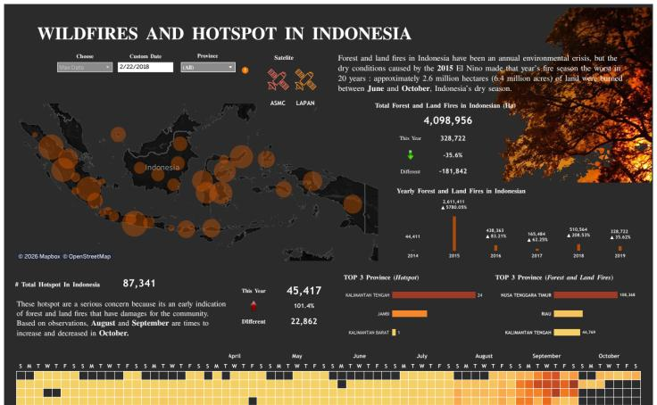

# From Wildfire to Market Demand

### Indonesia Wildfire Analysis & Mask Demand Insights

An Exploratory Data Analysis (EDA) and Business Analytics project to investigate the potential relationship between forest and land fires (Karhutla) in Indonesia, air quality, and the demand for protective masks.

The project uses Python to analyze hotspot activity, explore temporal patterns, and evaluate whether environmental conditions are associated with changes in mask sales.

> **Important:** The included mask sales dataset is simulated data for demonstration purposes only. It does not represent actual mask sales in Indonesia. Correlation does not imply causation.

---

## Project Overview

Forest and land fires (Karhutla) can contribute to air pollution and increase exposure to harmful particles such as PM2.5.

This project explores whether changes in wildfire activity and air quality indicators are associated with changes in mask demand.

### Business Objectives

- Analyze monthly wildfire hotspot trends in Indonesia.
- Identify periods with the highest hotspot activity.
- Explore regional patterns of wildfire activity.
- Analyze mask sales trends over time.
- Investigate potential relationships between hotspot activity and mask demand.
- Develop data-driven recommendations for inventory planning.

---

## Business Questions

1. How does wildfire hotspot activity change over time in Indonesia?
2. Which months experience the highest hotspot activity?
3. Which regions have the highest number of hotspot detections?
4. Is there an association between wildfire activity and mask sales?
5. Does air quality deterioration potentially influence mask demand?
6. How can businesses improve inventory planning during periods of increased environmental risk?

---

## Tools & Technologies

| Tool | Purpose |
|---|---|
| Python | Data analysis and processing |
| Pandas | Data cleaning and manipulation |
| NumPy | Numerical computation |
| Matplotlib | Data visualization |
| Seaborn | Statistical visualization |
| SciPy | Statistical analysis |
| Plotly | Interactive charts |
| Streamlit | Interactive dashboard |
| Jupyter Notebook | Exploratory Data Analysis |
| Git & GitHub | Version control and documentation |

---

## Dataset & Data Sources

### 1. Wildfire Hotspot Data

**Source:** NASA FIRMS (Fire Information for Resource Management System)

https://firms.modaps.eosdis.nasa.gov/download/

Used to analyze active fire detections, including:

- Acquisition date
- Latitude and longitude
- Confidence level
- Fire Radiative Power (FRP)
- Satellite information

### 2. Indonesian Forest Fire Information

**Source:** SiPongi+ – Ministry of Forestry

https://sipongi.gakkum.kehutanan.go.id/

Used as a supporting reference for Indonesian forest and land fire information.

### 3. Air Quality Data

**Source:** BMKG

https://www.bmkg.go.id/kualitas-udara/pm25

PM2.5 data can provide additional context for evaluating air quality conditions.

### 4. Mask Sales Data

Sales data should contain the following fields:

| Column | Description |
|---|---|
| date | Transaction date |
| province | Sales location |
| units_sold | Number of masks sold |
| revenue_idr | Total sales revenue |

**Data status:**
- Simulated data: Used for initial development and testing.
- Real data: To be integrated when verified and legally available.

---

## Project Structure

```text
karhutla-mask-demand/
│
├── app.py
│
├── data/
│   ├── raw/
│   ├── sample/
│   └── processed/
│
├── notebooks/
│   └── analysis.ipynb
│
├── reports/
│   └── figures/
│
├── src/
│   ├── __init__.py
│   ├── data_loader.py
│   ├── analysis.py
│   └── make_demo_data.py
│
├── requirements.txt
├── .gitignore
└── README.md
```

---

## Methodology

The project follows a structured data analytics workflow:

### 1. Data Collection
Collect wildfire hotspot, air quality, and mask sales datasets from available sources.

### 2. Data Cleaning
- Handle missing values.
- Remove duplicate records where appropriate.
- Convert date columns into datetime format.
- Validate numerical values.
- Standardize geographic and time dimensions.

### 3. Exploratory Data Analysis (EDA)
Explore trends and patterns through descriptive statistics and visualizations.

### 4. Temporal Analysis
Analyze monthly and seasonal hotspot patterns and compare them with mask sales trends.

### 5. Regional Analysis
Explore hotspot distribution by province using geographic information where available.

### 6. Statistical Analysis
Use Pearson and Spearman correlation to explore relationships between environmental indicators and mask sales.

### 7. Business Insights
Translate analytical findings into practical recommendations for inventory planning and demand monitoring.

---

## Dashboard & Visualization



The project uses Streamlit and Plotly to provide an interactive dashboard.

Planned dashboard components:

- Monthly Hotspot Trend
- Hotspot Distribution by Province
- Mask Sales Performance
- Hotspot vs. Mask Sales Correlation
- Business Insights and Recommendations

Run the dashboard locally:

```bash
streamlit run app.py
```

---

## Key Findings & Business Insights

*To be completed after analyzing verified real-world datasets.*

The analysis will focus on:

- Identifying peak wildfire activity periods.
- Understanding regional hotspot patterns.
- Exploring changes in mask sales over time.
- Evaluating statistical relationships between environmental indicators and demand.

Simulated data results must not be interpreted as actual market findings.

---

## Business Recommendations

Depending on the findings from real datasets, businesses may consider:

1. Monitoring wildfire activity and air quality indicators.
2. Preparing mask inventory before periods of elevated environmental risk.
3. Prioritizing distribution based on actual demand and regional exposure.
4. Monitoring sales trends to avoid stock shortages.
5. Combining environmental indicators with historical sales data for demand forecasting.

---

## Limitations

- Satellite hotspot detections do not directly represent the number of fires or burned area.
- Smoke exposure depends on wind direction, atmospheric conditions, and geographic location.
- Hotspot activity alone is not a sufficient indicator of population exposure to smoke.
- Mask sales are influenced by pricing, promotions, stock availability, distribution, purchasing power, and consumer behavior.
- Simulated sales data cannot be used to establish actual market demand.
- Correlation does not establish causation.

---

## Future Improvements

- Integrate verified historical wildfire datasets.
- Incorporate historical PM2.5 data.
- Perform spatial analysis using GeoPandas.
- Build an interactive geographic hotspot map.
- Investigate time-lag relationships between air quality and mask demand.
- Develop demand forecasting models using verified historical sales data.

---

## Project Status

**Status:** In Development

This project is intended as a Data Analyst portfolio case study combining environmental data analysis and business intelligence.

---

## Author

**Veendy Suseno**

GitHub: https://github.com/veendysuseno

LinkedIn: https://linkedin.com/in/veendysuseno/
